# ⚡ Sistem Informasi Pemesanan Instalasi Listrik PT. Eksavindo Mitra Mandiri Berbasis Web

[](https://www.php.net)
[](https://laravel.com)
[](https://www.mysql.com)
[](https://getbootstrap.com)
[](https://midtrans.com)
[](#)
[](#)

> **Tugas Akhir / Laporan Proyek Sistem Informasi**  
> **Program Studi:** S1 Ilmu Komputer, Fakultas Ilmu Komputer  
> **Perguruan Tinggi:** Universitas Muhammadiyah Metro  
> **Penyusun:** Handika Saputra (NPM: 24430011)  
> **Tahun Akademik:** 2026 / 2027  
> **Instansi Mitra:** PT. Eksavindo Mitra Mandiri (Kota Metro, Lampung)  

---

## 📑 Daftar Isi
1. [Ringkasan Proyek](#-ringkasan-proyek)
2. [Fitur Utama Sistem](#-fitur-utama-sistem)
3. [Perancangan Sistem & Diagram](#-perancangan-sistem--diagram)
   - [1. Flowchart Aliran Sistem Informasi (ASI) Swimlane](#1-flowchart-aliran-sistem-informasi-asi-swimlane-3-jalur)
   - [2. Activity Flowchart Siklus Pemesanan & Pembayaran QRIS End-to-End](#2-activity-flowchart-siklus-pemesanan--pembayaran-qris-end-to-end)
   - [3. Data Flow Diagram (DFD) Level 0 / Diagram Konteks](#3-data-flow-diagram-dfd-level-0--diagram-konteks)
   - [4. Data Flow Diagram (DFD) Level 1 (13 Proses)](#4-data-flow-diagram-dfd-level-1-13-proses)
   - [5. Use Case Diagram UML](#5-use-case-diagram-uml)
   - [6. Entity Relationship Diagram (ERD) Normalisasi 3NF](#6-entity-relationship-diagram-erd-normalisasi-3nf)
   - [7. Rancangan Relasi Antar Tabel](#7-rancangan-relasi-antar-tabel)
4. [Tangkapan Layar Antarmuka Aplikasi (Screenshots)](#-tangkapan-layar-antarmuka-aplikasi-screenshots)
   - [1. Halaman Masuk / Login Pengguna](#1-halaman-masuk--login-pengguna)
   - [2. Katalog Layanan dengan AJAX Live Search](#2-katalog-layanan-dengan-ajax-live-search)
   - [3. Detail Layanan Instalasi](#3-detail-layanan-instalasi)
   - [4. Keranjang Belanja Pemesanan](#4-keranjang-belanja-pemesanan)
   - [5. Form Checkout Multi-Alamat](#5-form-checkout-multi-alamat)
   - [6. Pembayaran GoPay QRIS Standar Nasional (Zero Manual Input)](#6-pembayaran-gopay-qris-standar-nasional-zero-manual-input)
   - [7. Kuitansi / Invoice Digital Resmi](#7-kuitansi--invoice-digital-resmi)
   - [8. Dashboard Administrator](#8-dashboard-administrator)
   - [9. Panel Manajemen Pesanan & Penjadwalan Teknisi (Administrator)](#9-panel-manajemen-pesanan--penjadwalan-teknisi-administrator)
   - [10. Panel Kelola Layanan & Produk Instalasi (Administrator)](#10-panel-kelola-layanan--produk-instalasi-administrator)
5. [Spesifikasi Teknologi](#-spesifikasi-teknologi)
6. [Struktur Direktori Proyek](#-struktur-direktori-proyek)
7. [Panduan Instalasi & Menjalankan Proyek](#-panduan-instalasi--menjalankan-proyek)
8. [Akun Pengujian Demo](#-akun-pengujian-demo)

---

## 📌 Ringkasan Proyek
**PT. Eksavindo Mitra Mandiri** merupakan badan usaha penyedia layanan instalasi, perawatan kelistrikan, serta proteksi petir di Kota Metro, Lampung. Dalam proses bisnis konvensional, pemesanan jasa listrik masih dilakukan manual melalui sambungan telepon atau kunjungan kantor. Hal ini menimbulkan berbagai kendala operasional, seperti pencatatan pesanan yang tercecer, estimasi spesifikasi teknis dan biaya paket yang kurang transparan bagi konsumen, verifikasi transfer bank yang memakan waktu, serta jadwal armada teknisi yang sering tumpang tindih.

Proyek ini menghadirkan **Sistem Informasi Pemesanan Instalasi Listrik Berbasis Web** yang mengintegrasikan:
1. **Katalog Digital Terstandar PUIL 2020 & SNI** (spesifikasi daya VA, fase 1-phase/3-phase, kelengkapan material kabel, serta kuota tim).
2. **Online Payment Gateway Midtrans (GoPay QRIS & Virtual Account)** dengan sistem nominal terkunci otomatis (*zero manual input*).
3. **Automated Dispatch & Scheduling Engine** yang secara otomatis memvalidasi status pesanan menjadi *Lunas/Diproses*, menugaskan armada teknisi, menetapkan tanggal pemasangan H+1, dan menerbitkan kuitansi digital sah bertanda verifikasi.

---

## ✨ Fitur Utama Sistem

### 👤 Modul Konsumen (Pelanggan)
- **Registrasi & Autentikasi Pengguna:** Pembuatan akun otomatis dengan format ID kustom berurutan (`USR00001`, `USR00002`, dst.).
- **Katalog Layanan Interaktif & AJAX Live Search:** Pencarian realtime tanpa reload berdasarkan nama paket, kategori layanan, daya, atau fase.
- **Detail Paket & Spesifikasi PUIL:** Informasi transparan mengenai daya VA, jenis instalasi (Rumah Tinggal, Komersil 3 Phase, Grounding Petir, Perawatan Panel), harga normal, dan potongan diskon promo aktif.
- **Keranjang Pemesanan Dinamis:** Penyesuaian jumlah unit paket dengan rekalkulasi subtotal secara instan.
- **Checkout Multi-Alamat:** Konsumen dapat memilih alamat tersimpan atau menambahkan alamat lokasi pemasangan baru secara langsung.
- **Metode Pembayaran Ganda:**
  - **Online Payment Gateway (GoPay QRIS):** QR Code Standar Pembayaran Nasional GPN tercetak otomatis sesuai total tagihan; verifikasi instan tanpa input manual.
  - **Transfer Rekening Bank Manual:** Dilengkapi opsi unggah foto bukti transfer bagi pelanggan konvensional.
- **Riwayat Pesanan & Pelacakan Armada:** Pemantauan status pengerjaan (*Menunggu Penjadwalan* $\rightarrow$ *Teknisi Ditugaskan* $\rightarrow$ *Menuju Lokasi* $\rightarrow$ *Selesai*).
- **Cetak Kuitansi / Invoice Digital:** Format kuitansi resmi siap cetak (dilengkapi stempel LUNAS / VERIFIED untuk arsip transaksi).

### 🛠️ Modul Administrator
- **Dashboard Statistik Operasional:** Monitoring metrik total pesanan, jumlah verifikasi tertunda, pekerjaan selesai, dan akumulasi omset terverifikasi.
- **Manajemen Pesanan & Penjadwalan Cerdas:** Verifikasi transaksi, pengubahan status pengerjaan, dan tombol satu klik *"Jadwalkan Otomatis (Besok)"*.
- **Live Search Pesanan AJAX:** Filter instan tabel pesanan berdasarkan ID pesanan, nama pemesan, nomor telepon, alamat, atau paket layanan.
- **CRUD Master Paket Layanan / Produk:** Pengaturan spesifikasi daya VA, fase, harga paket, deskripsi kabel SNI, dan kuota teknisi.
- **CRUD Kategori Layanan:** Pengelompokan jenis pekerjaan instalasi kelistrikan.
- **CRUD Rekening Bank Resmi:** Pengaturan nomor rekening bank transfer PT. Eksavindo.
- **CRUD Diskon Promo:** Pengaturan diskon nominal aktif yang otomatis memotong tagihan konsumen saat checkout.

---

## 📐 Perancangan Sistem & Diagram

### 1. Flowchart Aliran Sistem Informasi (ASI) Swimlane (3 Jalur)

<p align="center">
  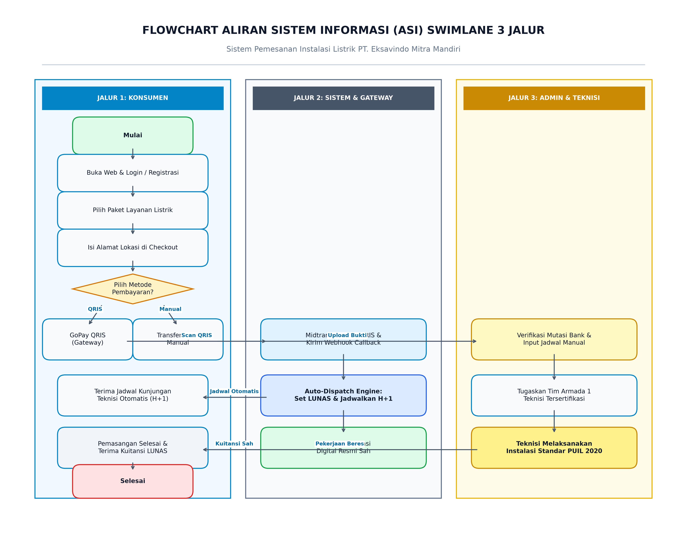
</p>

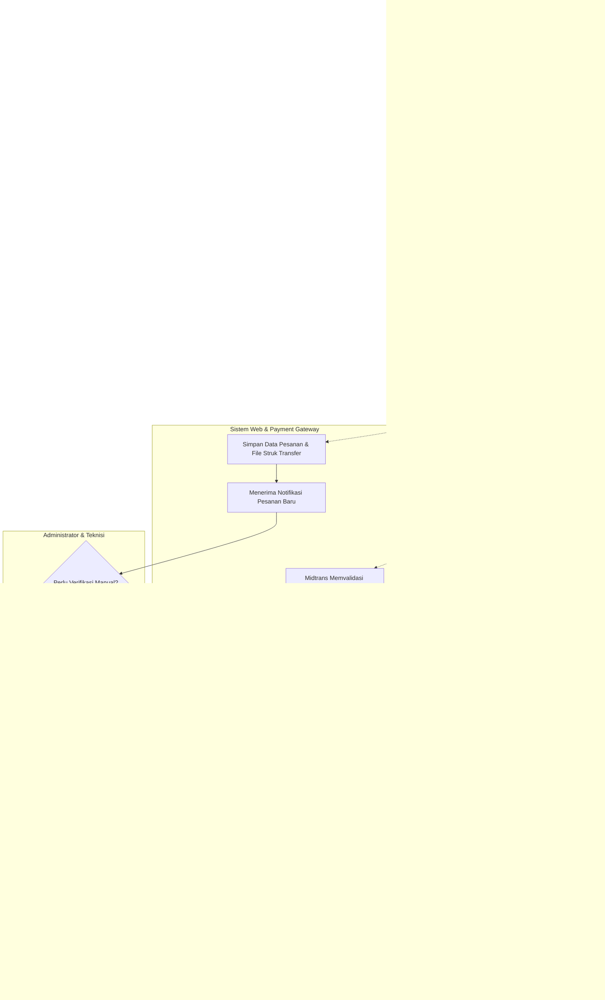

---

### 2. Activity Flowchart Siklus Pemesanan & Pembayaran QRIS End-to-End

<p align="center">
  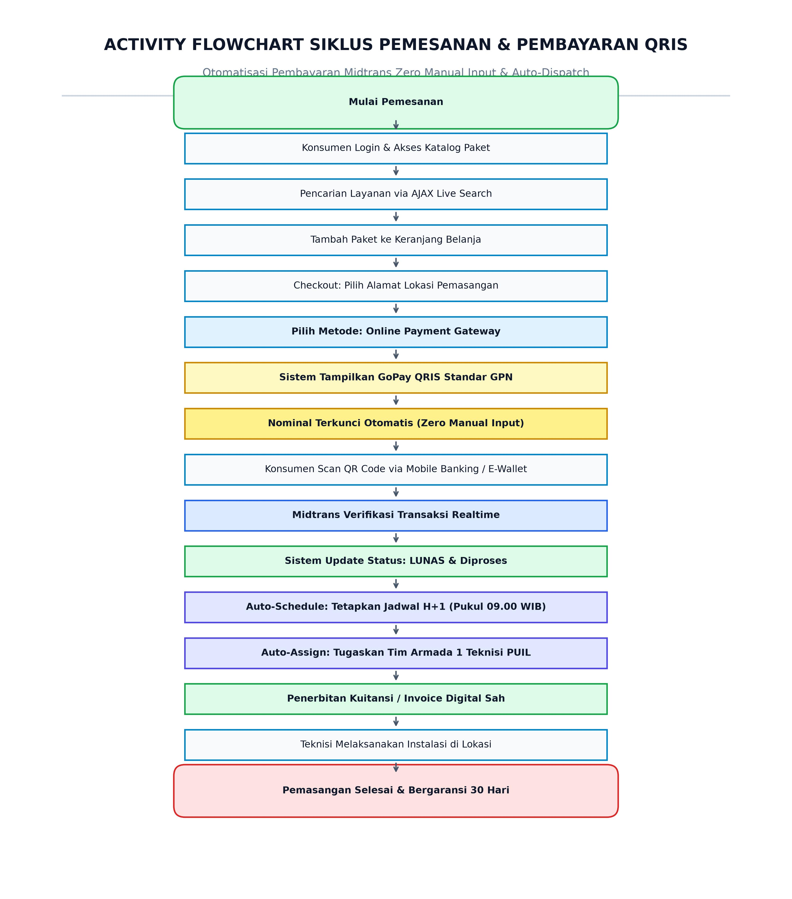
</p>

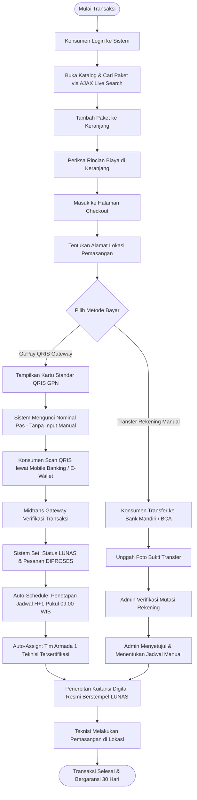

---

### 3. Data Flow Diagram (DFD) Level 0 / Diagram Konteks

<p align="center">
  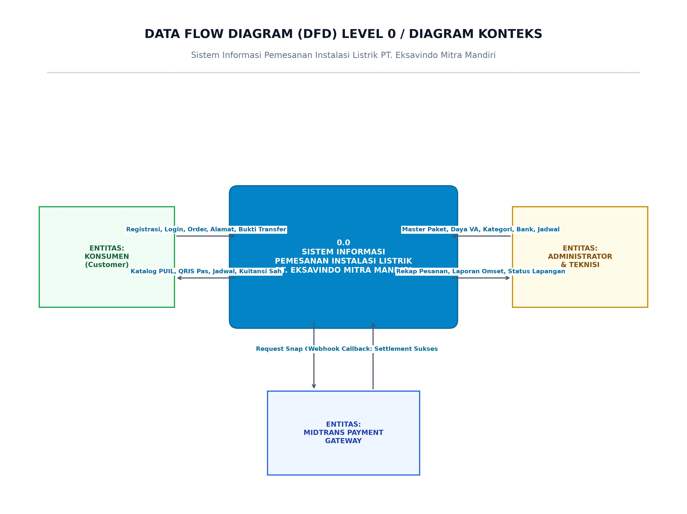
</p>

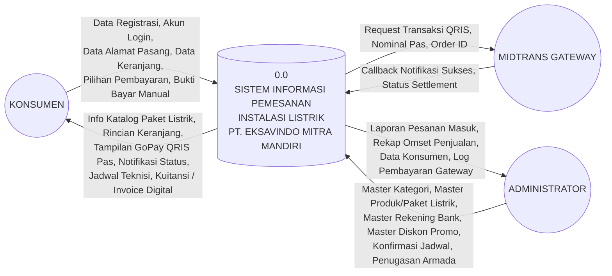

---

### 4. Data Flow Diagram (DFD) Level 1 (13 Proses)

<p align="center">
  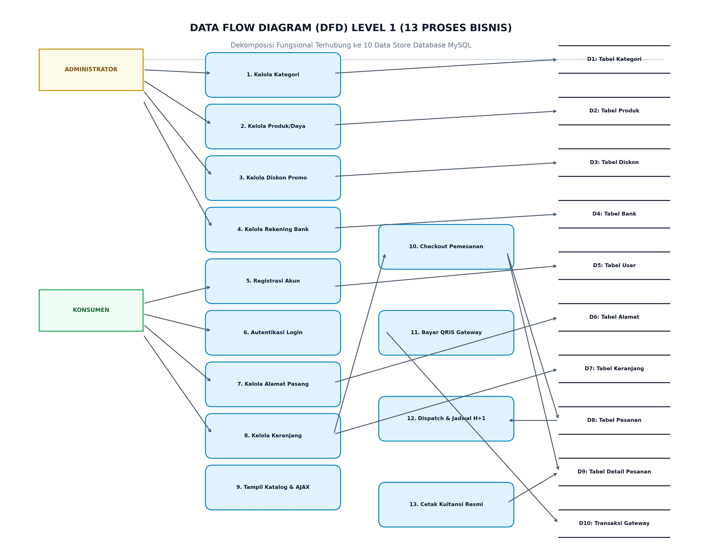
</p>

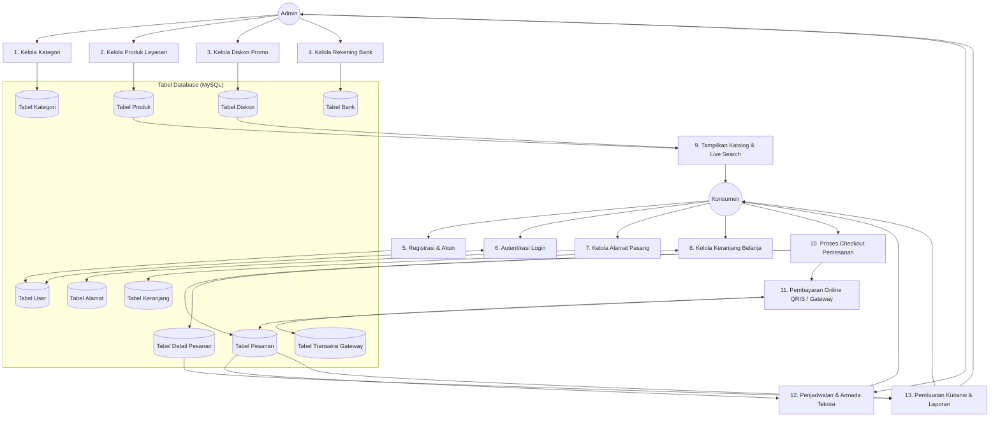

---

### 5. Use Case Diagram UML

<p align="center">
  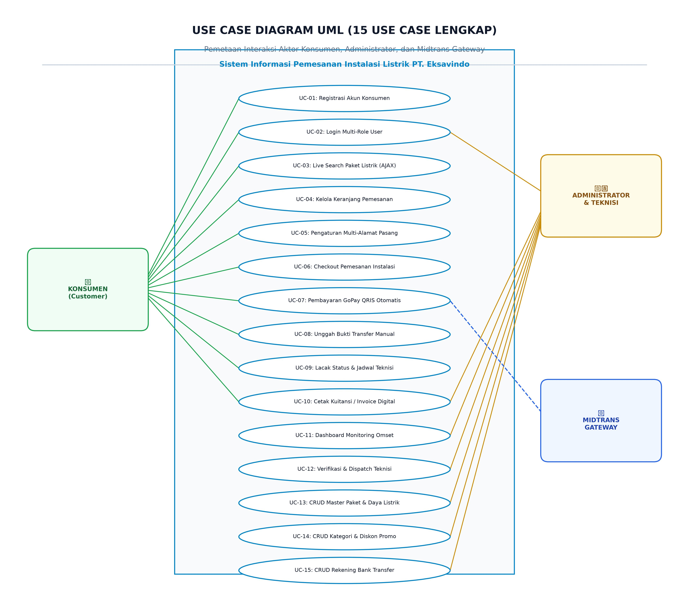
</p>

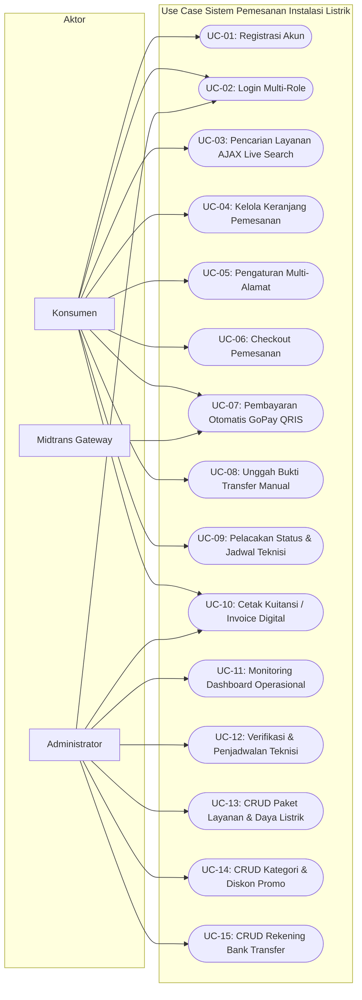

---

### 6. Entity Relationship Diagram (ERD) Normalisasi 3NF

<p align="center">
  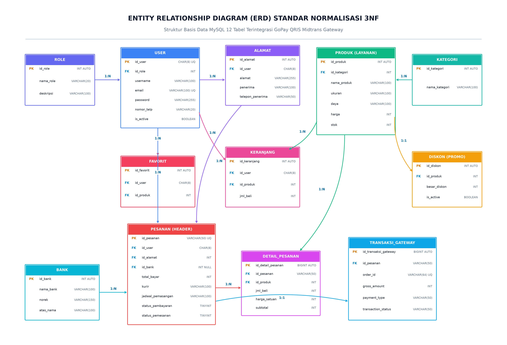
</p>

Rancangan database telah memenuhi standardisasi normalisasi **1NF, 2NF, hingga 3NF**:
- **1NF:** Setiap atribut bersifat atomik, tanpa *repeating groups*. Item belanja pada transaksi dipisahkan ke tabel `detail_pesanan`.
- **2NF:** Seluruh atribut non-key bergantung penuh terhadap Primary Key masing-masing.
- **3NF:** Ketergantungan transitif dieliminasi. Diskon, kategori, alamat pasang, dan log transaksi gateway dipisahkan ke entitas terisolasi.

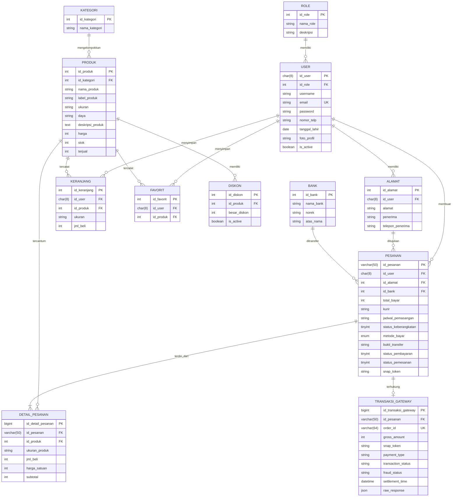

---

### 7. Rancangan Relasi Antar Tabel

<p align="center">
  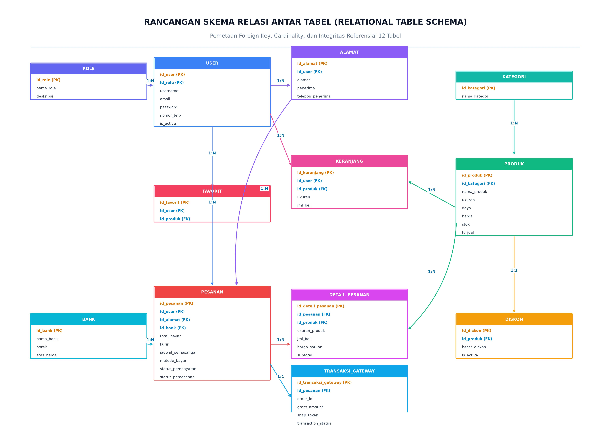
</p>

| Tabel | Primary Key (Eksplisit) | Foreign Key | Kardinalitas | Penjelasan Integritas Referensial |
|---|---|---|---|---|
| `role` | `id_role` | - | 1 : N | Mendefinisikan hak akses admin dan konsumen |
| `user` | `id_user` | `id_role` | 1 : N | Akun pengguna utama (`ADM00001`, `USR00001`) |
| `alamat` | `id_alamat` | `id_user` | 1 : N | Satu konsumen dapat menyimpan banyak titik lokasi pemasangan |
| `kategori` | `id_kategori` | - | 1 : N | Klasifikasi kategori instalasi (Rumah, Gedung, Panel, Grounding) |
| `produk` | `id_produk` | `id_kategori` | 1 : N | Master data paket layanan, daya VA, fase, dan material kabel SNI |
| `diskon` | `id_diskon` | `id_produk` | 1 : 1 | Potongan harga promo yang langsung memotong tagihan |
| `keranjang` | `id_keranjang` | `id_user`, `id_produk` | N : M | Menampung sementara pilihan layanan konsumen sebelum checkout |
| `favorit` | `id_favorit` | `id_user`, `id_produk` | N : M | Fitur wishlist paket layanan kelistrikan |
| `bank` | `id_bank` | - | 1 : N | Rekening tujuan pembayaran transfer manual kantor |
| `pesanan` | `id_pesanan` | `id_user`, `id_alamat`, `id_bank` | 1 : N | Header transaksi utama pemesanan dan jadwal teknisi |
| `detail_pesanan` | `id_detail_pesanan` | `id_pesanan`, `id_produk` | 1 : N | Itemized order yang menjamin normalisasi 1NF & 2NF terpenuhi |
| `transaksi_gateway` | `id_transaksi_gateway` | `id_pesanan` | 1 : 1 | Menampung audit trail transaksi online Midtrans & Webhook |

---

## 📸 Tangkapan Layar Antarmuka Aplikasi (Screenshots)

Berikut adalah dokumentasi tangkapan layar antarmuka sistem yang telah selesai diimplementasikan:

### 1. Halaman Masuk / Login Pengguna
Menampilkan form autentikasi kredensial pengguna yang aman dengan pemisahan hak akses antara Konsumen dan Administrator.
*(Akses: `index.php?page=login`)*

<p align="center">
  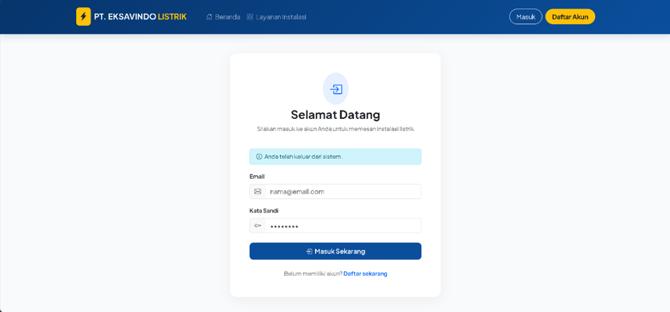
</p>

---

### 2. Katalog Layanan dengan AJAX Live Search
Menampilkan seluruh paket instalasi listrik dengan fitur pencarian instan (tanpa reload halaman). Hasil pencarian menyaring nama paket, kapasitas daya VA, dan kategori secara realtime dengan teknik *debounce*.
*(Akses: `index.php?page=katalog`)*

<p align="center">
  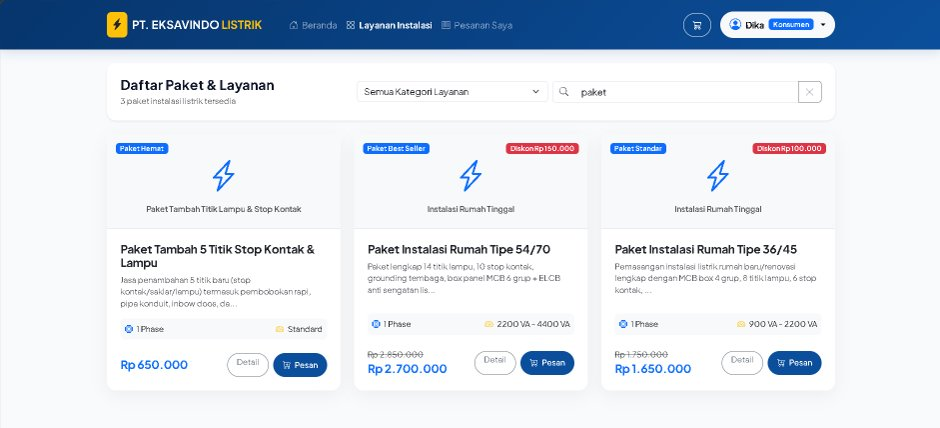
</p>

---

### 3. Detail Layanan Instalasi
Menampilkan rincian teknis lengkap (fase listrik, rentang daya VA, standar PUIL 2020 & SNI, garansi resmi 30 hari) serta input kuantitas pemesanan.
*(Akses: `index.php?page=detail_produk&id=...`)*

<p align="center">
  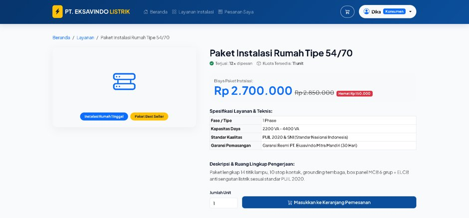
</p>

---

### 4. Keranjang Belanja Pemesanan
Menampilkan daftar item pesanan, kalkulasi otomatis subtotal item, potongan diskon promo aktif, rincian biaya pengiriman teknisi gratis area Metro, dan tombol navigasi menuju proses checkout.
*(Akses: `index.php?page=keranjang`)*

<p align="center">
  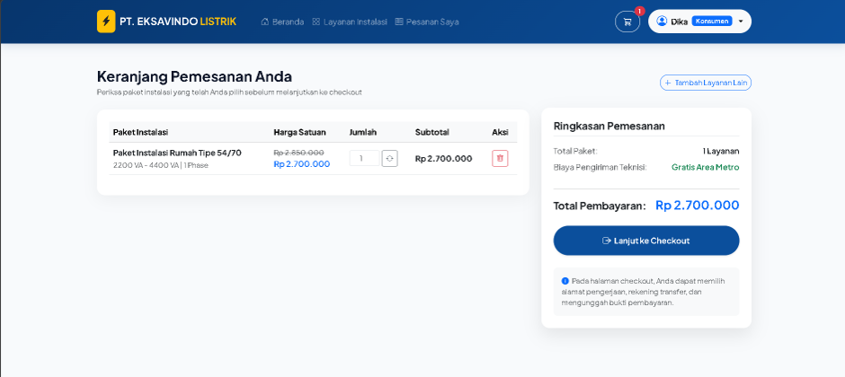
</p>

---

### 5. Form Checkout Multi-Alamat
Fitur fleksibel penentuan titik lokasi pengerjaan instalasi listrik: pelanggan dapat memilih alamat tersimpan atau menambahkan alamat pemasangan baru dengan tipe bangunan (Rumah / Komersial / Industri), kode pos, kota, nomor WhatsApp, serta patokan khusus teknisi sebelum menyelesaikan pemesanan.
*(Akses: `index.php?page=checkout`)*

<p align="center">
  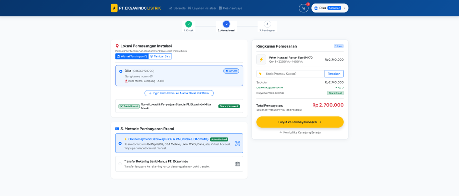
</p>

---

### 6. Pembayaran GoPay QRIS Standar Nasional (Zero Manual Input)
Tampilan kartu standar nasional QRIS GPN terintegrasi Payment Gateway Midtrans. Nominal tagihan terkunci otomatis dari sistem sesuai total tagihan pesanan (`ORD-20261117-8E4E7`), sehingga pelanggan cukup scan barcode tanpa perlu input harga manual di aplikasi e-wallet.
*(Akses: `index.php?page=bayar_gateway&id=...`)*

<p align="center">
  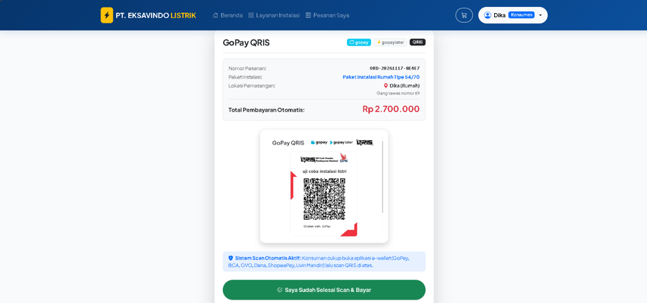
</p>

---

### 7. Kuitansi / Invoice Digital Resmi
Dokumen tagihan dan bukti pembayaran sah lengkap dengan stempel status **LUNAS / VERIFIED**, nomor pesanan, rincian biaya, jadwal kunjungan, penugasan armada teknisi bersertifikat PT. Eksavindo, serta tombol cetak / simpan langsung (*Print to PDF*).
*(Akses: `index.php?page=kuitansi&id=...`)*

<p align="center">
  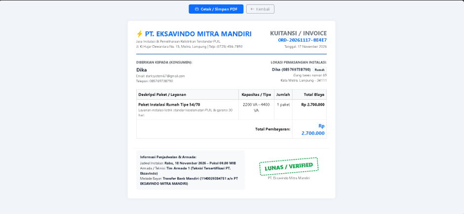
</p>

---

### 8. Dashboard Administrator
Panel ringkasan operasional yang menyajikan kartu metrik total pesanan, jumlah verifikasi tertunda, pemasangan selesai, akumulasi total omset terverifikasi (Rp 10.400.000), tautan cepat CRUD, serta tabel pemantauan pesanan masuk terbaru.
*(Akses: `index.php?page=admin_dashboard`)*

<p align="center">
  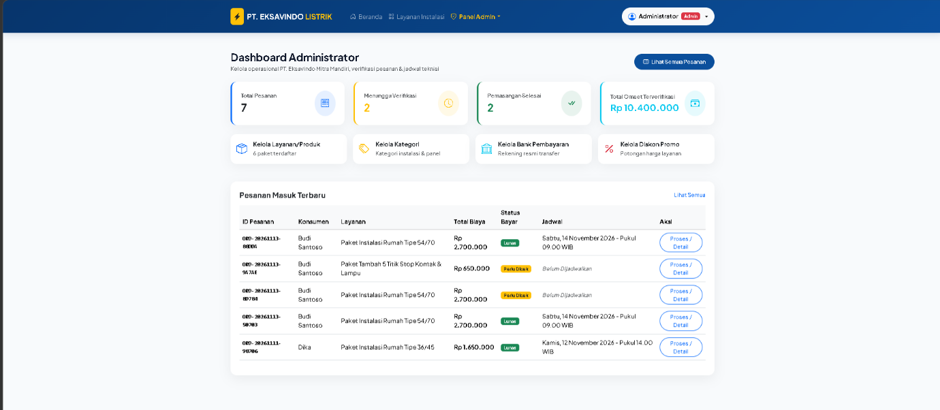
</p>

---

### 9. Panel Manajemen Pesanan & Penjadwalan Teknisi (Administrator)
Tabel kontrol admin untuk pemrosesan detail pesanan: verifikasi status pembayaran, penugasan nama armada teknisi PT. Eksavindo, penentuan jadwal kunjungan instalasi, serta pembaruan progres pengerjaan di lokasi hingga status selesai.
*(Akses: `index.php?page=admin_pesanan_detail&id=...`)*

<p align="center">
  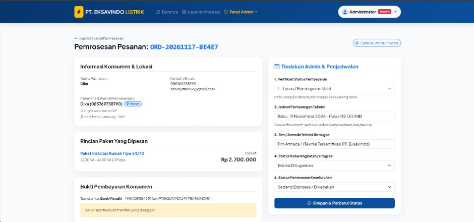
</p>

---

### 10. Panel Kelola Layanan & Produk Instalasi (Administrator)
Form dan tabel kontrol CRUD master data paket instalasi kelistrikan: penambahan paket baru, pemfilteran realtime, pengaturan kategori, spesifikasi fase/daya VA, harga satuan paket, kuota tim, serta monitoring jumlah paket yang telah terjual.
*(Akses: `index.php?page=admin_produk`)*

<p align="center">
  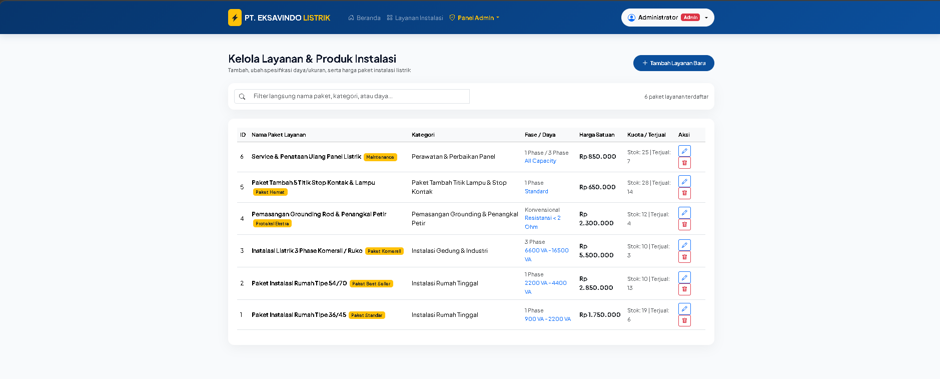
</p>

---

## 💻 Spesifikasi Teknologi

| Komponen | Spesifikasi / Library | Keterangan |
|---|---|---|
| **Bahasa Pemrograman** | PHP 8.2 / 8.4+ | Menggunakan arsitektur MVC bersih & siap migrasi ke Laravel |
| **Framework / Core** | Native MVC & Laravel 11.x Ready | Struktur Model Eloquent, Controller, dan View Blade telah disiapkan |
| **Database Management System** | MySQL 8.0+ / MariaDB & TiDB Cloud (Serverless) | Engine InnoDB / TiKV, Normalisasi 3NF, Mendukung Cloud-Native Distributed SQL |
| **Frontend Styling** | Bootstrap 5.3.3 + Custom CSS | Tampilan modern, responsive pada layar smartphone maupun desktop |
| **Icon Library** | Bootstrap Icons v1.11.3 | Representasi simbol grafis interaktif |
| **Tipografi** | Google Fonts: Plus Jakarta Sans | Tampilan profesional berstandar antarmuka modern |
| **Payment Gateway** | Midtrans Sandbox Engine | Mendukung GoPay QRIS, BCA VA, BNI VA, Mandiri Bill, E-Wallet |
| **Asynchronous Engine** | Vanilla JavaScript Fetch API (AJAX) | Live search realtime dengan teknik *debounce* hemat request |
| **Web Server** | Apache (XAMPP) / PHP Built-in Server | Fleksibel dijalankan lokal maupun diunggah ke web hosting |

---

## 📁 Struktur Direktori Proyek

```text
c:\pemesanan-instalasi-listrik\
│
├── index.php                          # Front Controller & Routing Utama
├── JALANKAN_WEB.bat                   # Skrip Otomatisasi Start Server Port 8000
├── database.sql                       # DDL Skema Database Awal
├── schema_instalasi_listrik_gateway.sql # DDL Database 3NF + Payment Gateway
├── tidb_migration.sql                 # Skrip Migrasi Lengkap Siap Eksekusi ke TiDB Cloud
├── .env.example                       # Contoh Konfigurasi Environment (MySQL / TiDB)
├── README.md                          # Laporan Dokumentasi Proyek GitHub
│
├── config/
│   ├── database.php                   # Koneksi Database PDO MySQL
│   └── app.php                        # Helper Global, Format Rupiah, Helper ID Kustom
│
├── controllers/
│   ├── AuthController.php             # Autentikasi Pengguna & Registrasi ID USR00001
│   ├── OrderController.php            # Keranjang, Checkout, & Simulasi Bayar Otomatis
│   └── AdminController.php            # Verifikasi, Penjadwalan Teknisi, & CRUD Master Data
│
├── views/
│   ├── layouts/
│   │   ├── header.php                 # Navbar Navigasi & Indikator Cart
│   │   └── footer.php                 # Footer Resmi & Hak Cipta
│   ├── auth/
│   │   ├── login.php                  # Form Masuk Pengguna
│   │   └── register.php               # Form Registrasi Konsumen Baru
│   ├── konsumen/
│   │   ├── home.php                   # Halaman Utama (Landing Page)
│   │   ├── katalog.php                # Katalog Layanan Listrik + AJAX Search
│   │   ├── katalog_item.php           # Template Kartu Layanan (Komponen AJAX)
│   │   ├── detail_produk.php          # Spesifikasi Teknis PUIL 2020
│   │   ├── keranjang.php              # Daftar Keranjang Belanja
│   │   ├── checkout.php               # Konfirmasi Titik Pasang & Metode Bayar
│   │   ├── bayar_gateway.php          # Halaman Pembayaran GoPay QRIS Standar GPN
│   │   ├── pesanan_saya.php           # Pelacakan Pesanan & Status Teknisi
│   │   ├── kuitansi.php               # Kuitansi Digital Resmi Siap Cetak
│   │   └── profil.php                 # Manajemen Profil & Multi-Alamat
│   └── admin/
│       ├── dashboard.php              # Statistik Omset & Ringkasan Transaksi
│       ├── pesanan.php                # Kelola Pesanan + AJAX Live Search
│       ├── pesanan_detail.php         # Dispatch Armada & Penjadwalan Otomatis
│       ├── produk.php                 # CRUD Master Paket Instalasi
│       ├── kategori.php               # CRUD Master Kategori Layanan
│       ├── bank.php                   # CRUD Rekening Bank Transfer
│       └── diskon.php                 # CRUD Promo Diskon Aktif
│
├── laravel-listrik/                   # Struktur Arsitektur Laravel Lengkap (Model & Service)
│   ├── app/
│   │   ├── Models/                    # Role, User, Produk, Pesanan, TransaksiGateway, dll.
│   │   ├── Services/MidtransService.php # Service Generator Snap Token & Webhook SHA512
│   │   └── Http/Controllers/          # Controller Konsumen, Admin, Auth
│   └── routes/web.php                 # Routing Laravel RESTful
│
├── screenshot/                        # Tangkapan Layar Antarmuka Sistem Web
│   ├── 01_login_pengguna.png          # Antarmuka Login Pelanggan & Admin
│   ├── 02_katalog_layanan_instalasi.jpg # Katalog Layanan & Live Search AJAX
│   ├── 03_detail_paket_layanan.jpg    # Detail Spesifikasi Teknis PUIL 2020
│   ├── 04_keranjang_pemesanan.png     # Keranjang Belanja Dinamis
│   ├── 05_form_checkout_multi_alamat.png # Form Checkout Multi-Alamat
│   ├── 06_pembayaran_qris_midtrans.png # Pembayaran GoPay QRIS Standar GPN Midtrans
│   ├── 07_kuitansi_invoice_digital.png # Kuitansi / Invoice Digital Sah (Lunas/Verified)
│   ├── 08_dashboard_administrator.png # Dashboard Monitoring Operasional Admin
│   ├── 09_admin_proses_pesanan.jpg    # Pemrosesan Pesanan & Dispatch Teknisi
│   └── 10_admin_kelola_produk_layanan.png # Master Data Paket Layanan & Produk Listrik
│
├── diagram-perancangan/               # Diagram Arsitektur & Perancangan Sistem (Format JPG)
│   ├── 1_flowchart_asi_swimlane.jpg   # Flowchart Aliran Sistem Informasi (ASI)
│   ├── 2_activity_flowchart_qris.jpg  # Activity Flowchart Pemesanan & QRIS
│   ├── 3_dfd_level_0_konteks.jpg      # DFD Level 0 (Diagram Konteks)
│   ├── 4_dfd_level_1.jpg              # DFD Level 1 (13 Proses)
│   ├── 5_use_case_diagram.jpg         # Use Case Diagram UML
│   ├── 6_erd_normalisasi_3nf.jpg      # ERD Normalisasi 3NF
│   └── 7_rancangan_relasi_antar_tabel.jpg # Rancangan Relasi Antar Tabel
│
├── assets/                            # Asset Gambar & Banner QRIS Nasional
│   └── qris_midtrans_standar.png      # Template QR Code Standar Pembayaran Nasional GPN
│
└── uploads/                           # Direktori Berkas Dinamis
    ├── bukti/                         # Arsip Unggahan Bukti Transfer Manual
    ├── produk/                        # Foto Dokumentasi Pekerjaan Listrik
    └── profil/                        # Foto Avatar Pengguna
```

---

## 🚀 Panduan Instalasi & Menjalankan Proyek

### Persyaratan Lingkungan (Prerequisites)
1. **PHP:** Versi 8.2 atau lebih baru (ekstensi `pdo_mysql`, `curl`, `mbstring`, `fileinfo` aktif).
2. **Database:** MySQL 8.0+ atau MariaDB (tersedia di XAMPP).
3. **Web Browser:** Google Chrome, Mozilla Firefox, atau Microsoft Edge versi terbaru.

### Langkah-Langkah Menjalankan:
1. **Kloning / Unduh Repositori:**
   ```bash
   git clone https://github.com/USERNAME/pemesanan-instalasi-listrik.git
   cd pemesanan-instalasi-listrik
   ```
2. **Nyalakan Layanan MySQL:**
   Buka **XAMPP Control Panel**, lalu klik **Start** pada modul **MySQL**.
3. **Impor Database:**
   Buat database bernama `pemesanan_instalasi_listrik` di phpMyAdmin, kemudian impor berkas:
   - File skrip: [`database.sql`](file:///c:/pemesanan-instalasi-listrik/database.sql) atau [`schema_instalasi_listrik_gateway.sql`](file:///c:/pemesanan-instalasi-listrik/schema_instalasi_listrik_gateway.sql).
   *(Atau jalankan skrip `php setup_db.php` di terminal).*
4. **Jalankan Aplikasi Web:**
   - **Cara 1 (Satu Klik):** Klik dua kali berkas [`JALANKAN_WEB.bat`](file:///c:/pemesanan-instalasi-listrik/JALANKAN_WEB.bat). Browser Anda akan otomatis terbuka.
   - **Cara 2 (Terminal):**
     ```bash
     php -S 0.0.0.0:8000
     ```
5. **Buka di Browser:**
   Buka alamat: **[http://localhost:8000](http://localhost:8000)**

---

## 🔑 Akun Pengujian Demo

| Peran (Role) | Email Login | Kata Sandi | Hak Akses Utama |
|---|---|---|---|
| **Administrator** | `admin@eksavindo.com` | `admin123` | Dashboard, Verifikasi Pembayaran, Penjadwalan Armada Teknisi, CRUD Paket Listrik, Kategori, Bank, & Diskon |
| **Konsumen (Demo)** | `budi@gmail.com` | `user123` | Jelajah Paket, Keranjang, Checkout, Pembayaran GoPay QRIS Otomatis, Lacak Status Teknisi, Cetak Kuitansi |
| **Konsumen Baru** | *(Dapat mendaftar akun baru secara mandiri melalui tombol "Daftar Akun")* | Bebas | Fitur penuh pelanggan dengan multi-alamat pemasangan |

---

 Profil Penyusun
Nama Mahasiswa: Handika Saputra
NPM: 24430011
Program Studi : S1 Ilmu Komputer
Perguruan Tinggi : Universitas Muhammadiyah Metro
Tahun Akademik: 2026 / 2027
Instansi Penelitian: PT. EKSAVINDO MITRA MANDIRI

© 2026 Handika Saputra (NPM: 24430011) - S1 Ilmu Komputer UM Metro
Perancangan Sistem Informasi Pemesanan Instalasi Listrik Pada PT. Eksavindo Mitra Mandiri Berbasis Website